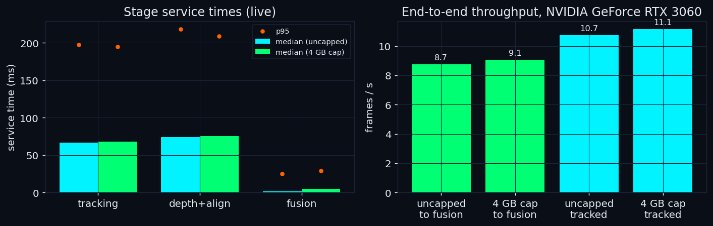
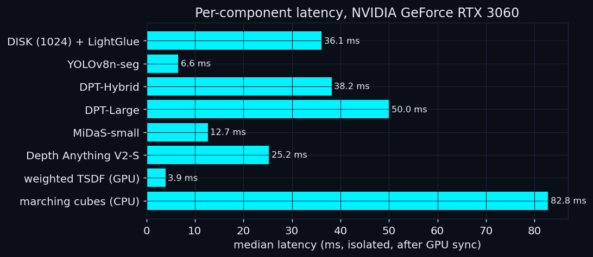
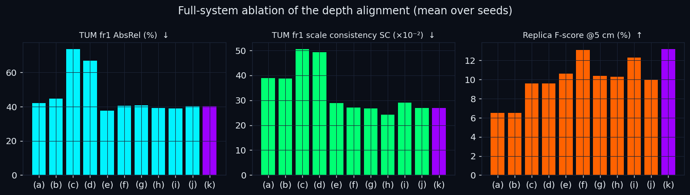

# AETHER-SLAM: Live 3D Room Scanner from a Single Camera

**Point a normal camera at a room, move it around slowly, and watch a coloured 3D
model of the real space build itself live, then export it as a `.ply`
mesh you can open in Blender, MeshLab, or any 3D tool.**

No depth sensor, no LiDAR, no special hardware: learned-feature visual odometry
for the camera's pose, a neural network for per-pixel relative depth,
**confidence-gated scale-shift filtering (CG-SSF)** to put every depth map on one
consistent scale with an uncertainty per pixel, and uncertainty-weighted TSDF
fusion on the GPU to weld it all into one surface. The whole system fits in the
memory of a 4 GB GPU.

---

## What it does

| Capability | How |
| :--- | :--- |
| **Live dense 3D reconstruction** | Sparse voxel-block TSDF on the GPU with per-pixel inverse-variance weights; marching cubes on its own thread; mesh streamed to the browser. |
| **Camera tracking** | DISK (1024 keypoints) + LightGlue matched against ≤256 map points → PnP-RANSAC + LM. Map points carry descriptors and survive short detection gaps. |
| **Consistent monocular depth** | MiDaS **DPT-Hybrid** (FP16) relative inverse depth, aligned by **CG-SSF** to map points that were **triangulated from parallax** (not to the network's own depth). |
| **People removed from the map** | YOLOv8n-seg person boxes are excluded from tracking, from the alignment anchors and from fusion; the closest person's distance is shown live. |
| **Audio detection** | Self-calibrating microphone voice-activity detection + a camera-derived source direction. |
| **Export** | Full-resolution vertex-coloured `room_mesh.ply`. |
| **No webcam? Replay a dataset** | Any TUM RGB-D sequence, Replica (NICE-SLAM renders) scene, or video file can be replayed live as a virtual camera. |
| **Runtime introspection** | `/api/perf` reports measured throughput, per-stage latency, capture→fusion age and GPU memory. |

---

## How to use it

1. Launch (see below) and open **http://localhost:8000**, then **LAUNCH DASHBOARD**.
2. **Move the camera slowly *sideways* and *forward*; don't just rotate it in
   place.** Monocular reconstruction needs translation (parallax).
3. Toggle **MESH** in the viewport to see the surface build up; the
   **Depth Alignment (CG-SSF)** panel shows the filter's state live.
4. Hit **EXPORT .PLY** to download the 3D model.

---

## How it works

```text
 camera / recorded sequence (30 Hz)
        │ size-1 overwrite buffers between all stages
        ▼
 ┌────────────────────────┐  pose + triangulated anchors  ┌──────────────────────────────┐
 │ SLAM thread (stream 1) │ ────────────────────────────► │ Semantic thread (stream 2)    │
 │ DISK+LightGlue vs. map │                               │ DPT-Hybrid ν, YOLO person box │
 │ PnP-RANSAC + LM        │ ◄──── aligned depth ───────── │ CG-SSF: ẑ, σ_z, weights ω      │
 │ parallax triangulation │      (new map points)         └──────────────┬───────────────┘
 └────────────────────────┘                                              ▼
                                       ┌──────────────────────────────────────────────┐
                                       │ Fusion thread (stream 3): weighted GPU TSDF   │
                                       │ Mesh thread: marching cubes → snapshot        │
                                       └──────────────────────┬───────────────────────┘
                                                              ▼
                               FastAPI WebSocket  ──►  React + Three.js dashboard
```

CG-SSF fits a scale and shift between the network's relative inverse depth and
the triangulated anchors with a closed-form robust estimator and its covariance,
tests whether both parameters are observable (a wall only determines the mean
depth → rank-one update), and tracks them with a Kalman filter whose χ² gate
rejects inconsistent frames. Its uncertainty becomes a per-pixel weight in the
TSDF. Details: [DOCUMENTATION.md](DOCUMENTATION.md).

---

## Install & run

### Windows (native)
```bat
run.bat                                   :: webcam
run.bat --replay C:\data\rgbd_dataset_freiburg1_desk   :: no webcam: replay a TUM / Replica folder or a video
run.bat --cap4                            :: emulate a 4 GB GPU
run.bat --help                            :: all options (--port, --setup, --rebuild, --no-browser)
```
The first run creates `venv` (with a signed python.org Python 3.10–3.12; install one
with `winget install --id Python.Python.3.10 --scope user` if needed), installs the
packages and CUDA PyTorch 2.5.1 when an NVIDIA GPU is present, and builds the web
interface. Later runs skip every step that is already up to date and start in
seconds; the browser opens at `http://localhost:8000` once the server answers.
If Windows Smart App Control blocks the venv's base Python, `run.bat` repoints the
venv to a signed Python 3.10 instead of reinstalling.

### Manual
```bat
set AETHER_SOURCE=C:\data\rgbd_dataset_freiburg1_desk
venv\Scripts\python -m backend.main
```

### Docker (Linux / NVIDIA Container Toolkit)
```bash
docker build -t aether-slam .
docker run --gpus all -p 8000:8000 --device /dev/video0 aether-slam
```

---

## Key configuration (`backend/config.py`)

| Setting | Default | Effect |
| :--- | :--- | :--- |
| `CAPTURE_SOURCE` / env `AETHER_SOURCE` | `webcam` | or a recorded sequence folder / video replayed live |
| `PORT` / env `AETHER_PORT` | `8000` | server port (`run.bat --port`) |
| `DEPTH_MODEL_TYPE` | `DPT_Hybrid` | `MiDaS_small`, `DPT_Large`, `DepthAnythingV2_Small` |
| `ALIGNMENT_VARIANT` | `cgssf` | CG-SSF; the ablation variants of the paper are also available |
| `DETECT_FEATURES` / `MAX_FEATURES` | `1024` / `256` | keypoints per frame / tracked map points |
| `TSDF_VOXEL_M` | `0.03` | reconstruction resolution (map units) |
| `PERSON_TRACKING_ENABLED` | `True` | person masking + distance read-out |
| `GPU_MEMORY_CAP_GB` / env `AETHER_GPU_CAP_GB` | none | cap GPU memory (e.g. `4` to emulate a 4 GB card) |

---

## API

| Endpoint | Description |
| :--- | :--- |
| `ws://localhost:8000/ws` | Live state / map / video / mesh stream. Send `"reset"` to restart the map. |
| `GET /api/status` | Server, GPU, capture source, alignment, fusion status. |
| `GET /api/perf` | Measured throughput, stage latencies, capture→fusion age, GPU memory. |
| `GET /api/export/mesh` | Download the reconstruction as `room_mesh.ply`. |
| `POST /api/save` / `GET /api/load` | Persist / read back the session. |

---

## Performance

<!-- PERF -->

All numbers below were measured on **NVIDIA GeForce RTX 3060** (12 GB), Intel(R) Core(TM) i5-14400F, 16 GB RAM, Windows 11, PyTorch 2.5.1 + CUDA 12.1. They are generated by `docs/fill_perf.py` from the measured results; the run logs, the aggregated results and the provenance of every benchmark number are available from the author on request.

### Live end-to-end (TUM fr1/room replayed at 30 Hz through the full server)

| | tracking FPS | frames reaching fusion / s | tracking (median ms) | depth + CG-SSF (median ms) | fusion (median ms) | frame age at fusion (median / p95 ms) | peak GPU memory |
| :-- | --: | --: | --: | --: | --: | --: | --: |
| uncapped | 10.7 | 8.7 | 66.4 | 74.4 | 1.7 | 220 / 396 | 0.92 GB |
| 4 GB cap | 11.1 | 9.1 | 68.1 | 75.7 | 4.6 | 234 / 448 | 0.91 GB |



### Per-component latency (isolated, median after GPU sync)

| component | latency (ms) | memory (MB) | TUM fr1 AbsRel of the full system (seed 0) |
| :-- | --: | --: | --: |
| DISK (1024) + LightGlue | 36.1 | 451.7 | – |
| YOLOv8n-seg (320 px) | 6.6 | 79.0 | – |
| DPT-Hybrid (default) | 38.2 | 527.1 | 41.4 % |
| DPT-Large | 50.0 | 1318.7 | 37.9 % |
| MiDaS-small | 12.7 | 87.2 | 42.3 % |
| Depth Anything V2-S | 25.2 | 167.5 | 37.2 % |
| CG-SSF update (CPU) | 0.25 | – | – |
| depth, σ_z, weights (GPU) | 0.66 | – | – |
| weighted TSDF integration (GPU) | 3.9 | 234.8 | – |
| marching cubes (CPU thread) | 82.8 | – | – |



### Full-system ablation (TUM RGB-D fr1 × 9, Replica × 8, mean over seeds 0, 1, 2)

| variant | TUM AbsRel % ↓ | TUM δ₁ % ↑ | TUM SC ×10⁻² ↓ | Replica Acc. cm ↓ | Replica Comp. cm ↓ | Replica F % ↑ | Replica ATE cm ↓ |
| :-- | --: | --: | --: | --: | --: | --: | --: |
| (a) Depth-domain LS (prototype fit) | 42.0 | 25.0 | 38.9 | 51.1 | 63.2 | 6.5 | 46.6 |
| (b) (a) + EMA + reuse (prototype) | 44.7 | 20.3 | 38.7 | 51.1 | 65.4 | 6.5 | 47.9 |
| (c) Inverse-domain LS | 73.7 | 31.9 | 50.6 | 216.0 | 23.1 | 9.6 | 25.0 |
| (d) Inverse-domain IRLS | 66.7 | 34.1 | 49.3 | 212.2 | 23.4 | 9.6 | 23.5 |
| (e) (d) + EMA + reuse | 37.5 | 31.8 | 28.8 | 82.8 | 22.3 | 10.6 | 22.5 |
| (f) CG-SSF, time-indexed process noise | 40.4 | 27.4 | 27.0 | 31.1 | 37.0 | 13.1 | 22.6 |
| (g) CG-SSF w/o rank-one | 40.8 | 27.3 | 26.8 | 66.7 | 23.1 | 10.4 | 22.8 |
| (h) CG-SSF w/o gate | 39.1 | 29.3 | 24.3 | 68.0 | 22.9 | 10.3 | 22.6 |
| (i) CG-SSF, fixed gate threshold | 38.9 | 27.7 | 29.1 | 31.1 | 36.9 | 12.3 | 23.4 |
| (j) CG-SSF, uniform weights | 40.3 | 27.9 | 26.9 | 68.0 | 23.6 | 10.0 | 22.9 |
| (k) CG-SSF, weighted (full) | 40.3 | 27.9 | 26.9 | 30.3 | 38.6 | 13.2 | 22.9 |

Paired Wilcoxon tests over sequences (full CG-SSF vs. the variant): scale consistency vs. prototype (b) p = 0.008, vs. (e) p = 1.000; AbsRel vs. (e) p = 0.164; Replica accuracy vs. uniform weights (j) p = 0.016, completion vs. (j) p = 0.078.

**Reading:** uncertainty-weighted fusion (k) more than halves the Replica accuracy error of uniform weights (j), 68.0 cm to 30.3 cm, at the cost of completion. In the full system, the lightweight front end chosen for the 4 GB budget (no bundle adjustment, no loop closure) dominates the remaining error, and the filtered variants (e) to (k) differ little in depth accuracy; the paper compares the estimators with ground-truth poses.



### Trajectory (ATE RMSE after Sim(3) alignment)

- TUM fr1: 28.0 cm mean over the 7/9 sequences tracked without failure (fr1/room and fr1/rpy re-initialize). Published learned dense methods: 3.0–5.4 cm averaged over all nine (as reported in MASt3R-SLAM, Table 1).
- TUM fr3 dynamic (with / without person masking): walking_xyz 15.7 / 20.1 cm, walking_halfsphere 28.1 / 26.8 cm, sitting_xyz 14.3 / 10.6 cm.
- Replica: 22.9 cm; reconstruction Acc. 30.33 cm, Comp. 38.56 cm, completion ratio 14.1 %, F-score 13.2 % (published dense methods: 2.96–5.03 cm Acc., 64.7–83.7 % CR, measured by their authors on an RTX 3090 / A100; GlORIE-SLAM uses 15.2 GB of GPU memory).

<!-- /PERF -->

---

## Evaluation

`tip/` contains the complete, deterministic evaluation harness used for the
paper: synchronous replay of TUM RGB-D and Replica for every alignment variant and
seed, in-process metrics (ATE, depth AbsRel/δ₁/scale consistency, mesh
accuracy/completion/F-score), held-out noise calibration, a controlled
simulation, runtime profiling, and result aggregation with provenance. The run
logs and aggregated results are not part of this repository; they are available
from the author on request.

---

## Design constraints

* **Monocular, relative scale.** Distances (including the person distance) are in
  map units, not metres.
* **Lightweight tracking for a 4 GB budget.** Frame-to-map visual odometry without
  global optimization keeps the whole system within a 4 GB GPU. Learned SLAM
  systems with dense or patch-based bundle adjustment track more accurately with
  several times the memory (published GPU memory: DPV-SLAM 4.0 GB, DROID-SLAM
  8.5 GB, GlORIE-SLAM 15.2 GB).
* **Translate the camera.** Pure rotation gives no parallax and maps poorly.
* **Audio direction is camera-derived** (toward the detected person).

---

Built by **Sahaj Sinha**.
